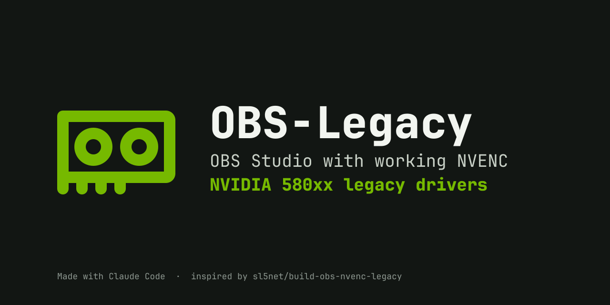
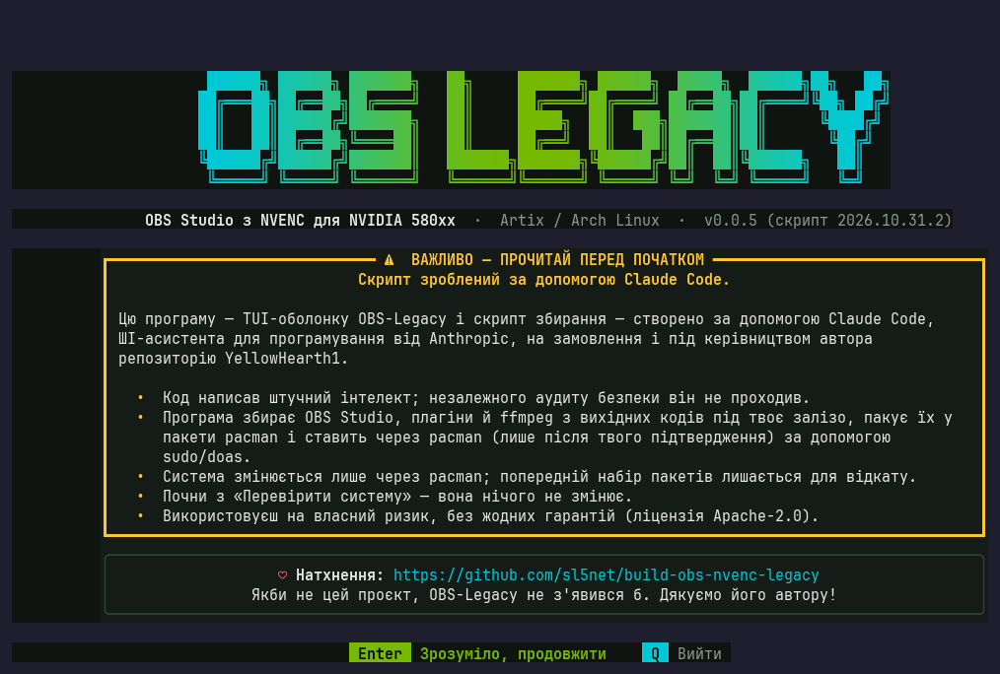
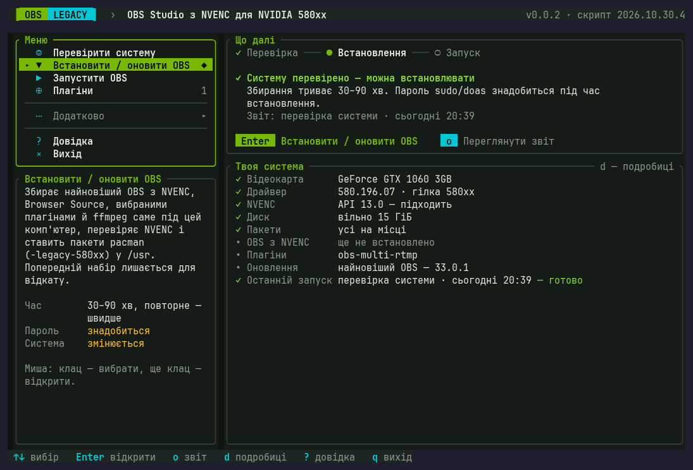
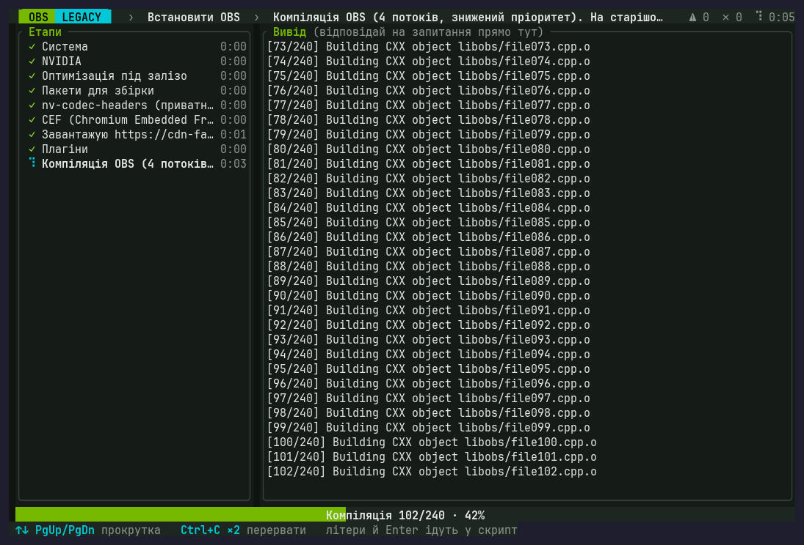
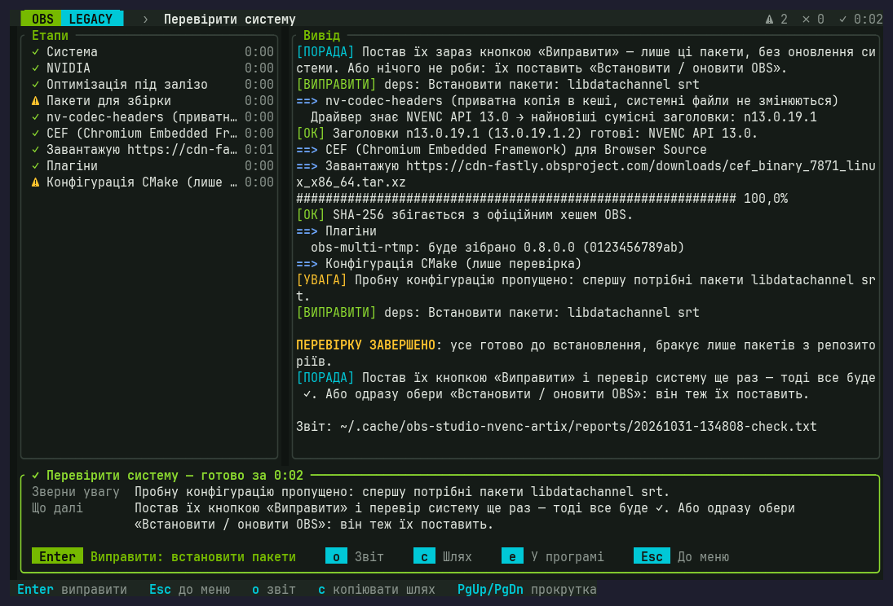
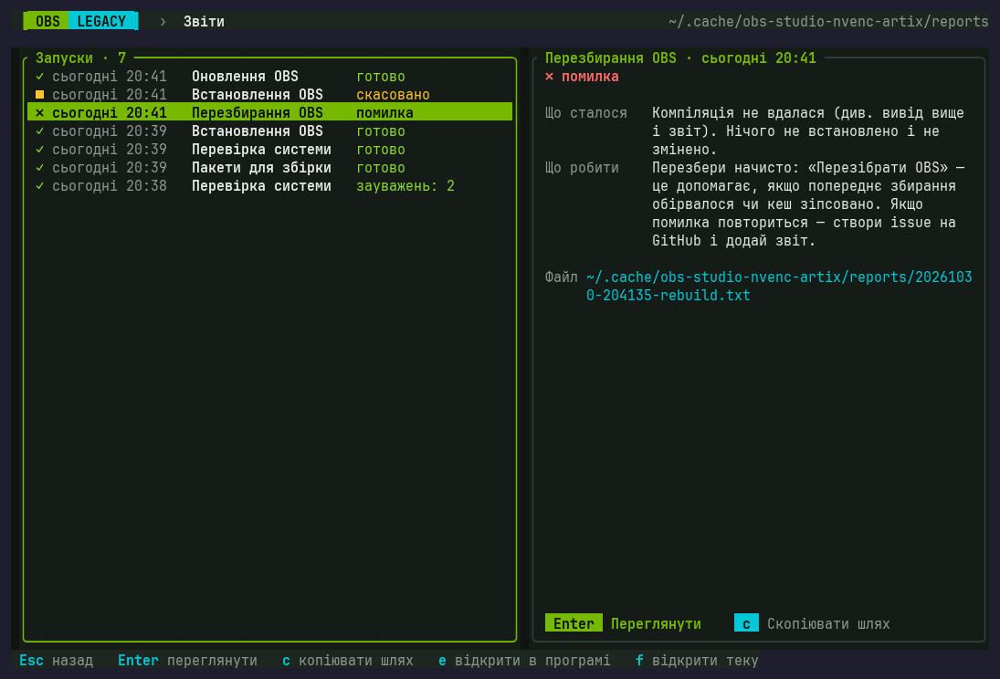
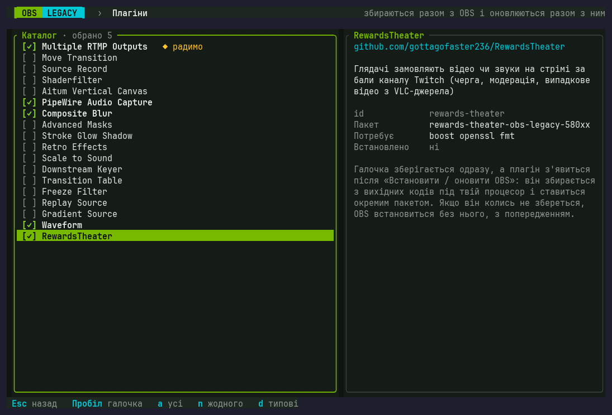

<p align="center">
  <a href="https://standforukraine.com/"></a>
</p>

<p align="center">
  <b>Ukraine is defending itself against Russia's full-scale invasion.</b><br>
  Support the Armed Forces of Ukraine and humanitarian aid through vetted funds and charities:<br>
  <a href="https://standforukraine.com/"><b>standforukraine.com</b></a>
</p>

---

<p align="center">
  
</p>

<p align="center">
  <b>English</b> · <a href="README.uk.md">Українська</a>
</p>

<p align="center">
  <b>OBS Studio with working NVENC for NVIDIA GPUs on the 580xx legacy drivers (GTX 900, GTX 1000, Titan V).</b><br>
  Artix and Arch Linux · a friendly terminal menu · check, install, update and roll back
</p>

<p align="center">
  <a href="https://github.com/YellowHearth1/OBS-Legacy/actions/workflows/ci.yml"></a>
  <a href="LICENSE"></a>
  
  
  
</p>

> [!WARNING]
> **This script was made with Claude Code.**
>
> The whole project — the `obs-legacy` program, the build script and the installer — was created with
> [Claude Code](https://claude.com/claude-code), Anthropic's AI coding assistant, commissioned and directed
> by the repository owner [YellowHearth1](https://github.com/YellowHearth1).
>
> - The code was written by an AI and has not been independently audited for security.
> - The program builds OBS Studio, its plugins and ffmpeg from source, packs them into pacman packages and
>   installs them with `pacman` (only after you confirm), using `sudo`/`doas`.
> - Start with **Check system** (*«Перевірити систему»*): it changes nothing.
> - Use at your own risk, with no warranty of any kind (see [LICENSE](LICENSE)).
>
> The program shows the same warning on its first screen at every launch (in Ukrainian:
> «Скрипт зроблений за допомогою Claude Code»).

<details>
<summary>What the first screen looks like</summary>
<p align="center">
  
</p>
</details>

> [!NOTE]
> **Inspiration.** OBS-Legacy grew out of the
> [sl5net/build-obs-nvenc-legacy](https://github.com/sl5net/build-obs-nvenc-legacy) script. Without it,
> this project would not exist. Many thanks to its author! ♥

> [!NOTE]
> **The interface is in Ukrainian** for now; English is planned. The menu is short, and this README names
> every item in both languages, e.g. **Install / update OBS** (*«Встановити / оновити OBS»*).

<p align="center">
  
</p>

## Why

The NVIDIA **580xx** driver branch is the last one that supports Maxwell, Pascal and Volta GPUs. It only
knows NVENC API **up to 13.0**, while OBS and ffmpeg from the Arch/Artix repositories are already built
against SDK 13.1. So in the regular OBS, NVENC hardware encoding never turns on, and streaming or
recording loads the CPU instead.

OBS-Legacy builds the **official OBS Studio** with a private copy of the NVENC 13.0 headers (system files
stay untouched), the official CEF for the Browser Source, the plugins you choose and ffmpeg — all
**optimized for your exact hardware** — and installs them as regular pacman packages with the
`-legacy-580xx` suffix: `obs-studio-legacy-580xx`, `<plugin>-legacy-580xx`, `ffmpeg-legacy-580xx`. They go
to the same places as the repo OBS (`/usr`), so pacman itself offers to replace `obs-studio` /
`obs-studio-git`, and plugins from the AUR install on top as usual. Packages are installed only after
`obs-nvenc-test` confirms that NVENC really works.

## Features

- **Guides you.** The home screen shows what is ready and what to do next; the cursor already sits on the
  right item, so you usually just press Enter. The menu has four steps; everything else lives under
  **More** (*«Додатково»*).
- **Explains and fixes.** After every run, a card says “what happened / what to do”, with advice from the
  script itself. Whatever can be fixed automatically (installing missing build packages, cleaning the
  cache) is fixed with the **Fix** button (*«Виправити»*). The full report opens right inside the program
  (`o`), its path is copied with `c`, and the file opens in your text editor with `e`.
- **Readable in any terminal.** A solid dark background keeps the text legible in transparent Kitty,
  Alacritty or Konsole. You can turn it off in the settings.
- **Opens with a click.** The **OBS-Legacy** entry in the application menu opens a terminal window by
  itself (kitty, konsole, alacritty, foot, wezterm, gnome-terminal, xterm and others).
- **Built for your hardware.** The program detects your distribution, CPU, GPU and driver by itself and
  picks the build parameters: compiler flags for this exact CPU (`-march=native`, e.g. AVX on an Ivy
  Bridge Xeon instead of the generic x86-64 of the repo packages), everything else from your
  distribution's `makepkg.conf`; the newest NVENC headers your driver knows; the CUDA architecture of your
  GPU for ffmpeg's CUDA filters (with several NVIDIA GPUs, the oldest one, so the filters run on all of
  them). The `obs-legacy` program itself is compiled for your CPU too. You see the whole profile in the
  **Hardware optimization** step (*«Оптимізація під залізо»*) of the report.
- **Real pacman packages.** `obs-studio-legacy-580xx` provides `obs-studio`, so AUR plugins that depend on
  it install as usual, and `pacman -Qs legacy-580xx` shows everything OBS-Legacy installed.
- **Browser Source built in.** The official OBS Linux CEF archive is used, and its SHA-256 is checked
  against the official hash in the OBS sources. Without `obs-browser` the build is not installed.
- **Plugins with checkboxes.** [obs-multi-rtmp](https://github.com/sorayuki/obs-multi-rtmp) (stream to
  several platforms at once) is on by default, plus 17 more to choose from, including
  [RewardsTheater](https://github.com/gottagofaster236/RewardsTheater). Each one is built from source for
  your OBS build and your CPU, becomes its own package (`obs-multi-rtmp-legacy-580xx`…) and is updated
  together with OBS.
- **ffmpeg with NVENC.** `ffmpeg-legacy-580xx` is the same ffmpeg as in the repositories (its Arch
  PKGBUILD), but with NVENC for the 580xx driver and tuned for your CPU: NVENC then works in OBS's
  “Custom Output (FFmpeg)”, in Kdenlive and in `ffmpeg` in the terminal. It is rebuilt only when the
  repositories get a new ffmpeg.
- **A long-term replacement for the repo OBS.** After system upgrades, a pacman hook inside the OBS
  package tells you when OBS needs a rebuild (or when a new ffmpeg is out). Previous package sets are kept,
  so rolling back needs no rebuild.
- **Tells you about updates.** If you like, a background check looks every 12 hours for a newer OBS, new
  plugin releases, a newer ffmpeg in the repositories and a new OBS-Legacy, and after system upgrades checks that your OBS build still finds
  its libraries. Each piece of news arrives once, as a desktop notification; a click opens OBS-Legacy. It
  runs as a user service of your init system (systemd, dinit, OpenRC, runit or s6) or from session
  autostart, without sudo.
- **Careful with your system.** The system changes only through pacman (`pacman -S` for build packages,
  `pacman -U` for the OBS-Legacy packages), only after you answer “y”, and never with `--noconfirm`. The
  script never runs a full system upgrade (`pacman -Syu`); building and packaging run without root.

## Installation

You need Artix or Arch, the NVIDIA 580xx driver, `git` and Rust. If Rust is missing, the installer offers
to install the `rust` package.

```bash
git clone https://github.com/YellowHearth1/OBS-Legacy.git
```

```bash
cd OBS-Legacy && ./install.sh
```

The installer builds `obs-legacy`, puts it into `~/.local/bin` and adds an **OBS-Legacy** entry to the
application menu (and, if you like, to the desktop). It also offers to turn on
[update notifications](#update-notifications). Then just click the entry or type `obs-legacy` in a
terminal.

## Usage

1. **Check system** (*«Перевірити систему»*). Driver, NVENC, packages, downloading the OBS and CEF
   sources. Changes nothing; takes 5–15 minutes.
2. **Plugins** (*«Плагіни»*) — optional. Tick what to build together with OBS.
3. **Install / update OBS** (*«Встановити / оновити OBS»*). Build for your hardware (30–90 minutes; the
   first time with ffmpeg takes longer, rebuilds are faster), NVENC test, library check, packaging and
   `pacman -U`. pacman asks whether to replace `obs-studio-git` (or `obs-studio`, `ffmpeg`, AUR plugins) —
   answer `y`. Your sudo/doas password and `y`/`n` answers are typed right in the program window; a
   yellow hint at the bottom tells you when.
4. **Start OBS as usual**: from the application menu, with the `obs` command or with **Launch OBS**
   (*«Запустити OBS»*).

<p align="center">
  
</p>

Updating is the same **Install / update OBS** item. Once OBS-Legacy is installed, it opens **Update OBS?**
(*«Оновити OBS?»*) with **Update** as the default button: the program first checks what is new (OBS,
plugin releases, ffmpeg, your hardware profile, libraries after system upgrades) and builds only when there
is something to update — otherwise it says “No updates” and changes nothing. The result card shows exactly
what changed, for example `OBS 33.0.0 → 33.0.1`. The **What next** panel (*«Що далі»*) tells you when a new
version is out.

The second button, **Rebuild** (*«Перезібрати»*, key `R`; also **More → Rebuild OBS**), builds everything
from scratch and installs it again even if nothing is new — for when a build was cut off (a power cut, a
closed window) or OBS misbehaves. If the program finds a build that was cut off, the **What next** panel
offers to rebuild by itself.

| Keys | Action |
|---|---|
| `↑↓`, `Enter` | select and open |
| `Esc` / `q` | back (on the home screen: quit) |
| `Enter` on the result card | apply the fix the script suggested (or go back to the menu) |
| `o` · `c` · `e` | view the report · copy its path · open it in an app |
| `d` | system status: short or detailed |
| `Space` | tick a plugin |
| `PgUp` / `PgDn` | scroll the output and reports |
| `Ctrl+C` ×2 | stop the current task |
| `?` / `F1` | help |
| mouse | click to select, click again to open, wheel to scroll |

## When something goes wrong

After every run the program briefly says what happened and what to do about it. The advice comes from
the script itself: which packages are missing, how to free disk space, what to check in the driver. If it
can be fixed right away, the main button of the card is **Fix**: for example, it installs the build
packages, after which the program offers to check the system again — and every step shows a check mark.

<p align="center">
  
</p>

Every run keeps a full report. All reports are listed under **More → Reports** (*«Додатково → Звіти»*),
with the outcome of each run; in the built-in viewer, `n` and `p` jump between warnings and errors.

<p align="center">
  
</p>

Your current OBS will not break: new packages are installed only after all checks pass. Don't like the
new version? Use **Roll back to another build** (*«Відкат на іншу збірку»*): it installs the previous
package set. The power went out while building? Choose **Rebuild OBS**: it starts from a clean build cache
and clears stale git locks. If pacman itself was cut off, the program tells you how to remove its leftover
lock (`/var/lib/pacman/db.lck`). Still stuck? Open an issue and attach the report.

Answer `[y/N]` questions with Latin `y` or `n`, or with the words «так» / «ні». With the Ukrainian layout
on, the `Y` key types «н»: the script notices that and asks again instead of cancelling. Cancelled the
installation at the last question anyway? The packages you waited for are kept: **Install / update OBS**
installs that ready set without rebuilding, and the home screen reminds you about it.

## FAQ

**My Kitty is transparent and the text gets lost on the wallpaper.** The interface has its own dark
background, so transparency does not affect it. If you want to see the terminal background, turn off
**Settings → Solid background** (*«Налаштування → Суцільний фон»*).

**The check says packages are missing and skips the trial CMake configuration.** Press **Fix** (or the
**Install packages** item): the program installs only those packages with pacman — pacman adds their
dependencies by itself — without upgrading the system. Then it offers to check the system again, and every
step gets a check mark. You can also do nothing: **Install / update OBS** installs these packages too.

**Do I have to remove `obs-studio` / `obs-studio-git` myself?** No. `obs-studio-legacy-580xx` conflicts
with any OBS package, so during installation pacman asks whether to replace it — answer `y`. The same goes
for AUR versions of the chosen plugins and for `ffmpeg`. To go back to the repo OBS: **More → Remove
OBS-Legacy**, then `sudo pacman -S obs-studio`.

**Can I install other plugins from the AUR?** Yes. OBS-Legacy installs OBS into `/usr` like the repo
package and provides `obs-studio`, so AUR plugins install on top of it as usual.

**How much faster is it?** The biggest win is NVENC itself: encoding moves from the CPU to the GPU. The
CPU-specific flags help OBS, its plugins and ffmpeg further (for example, AVX is used where the repo
packages only assume SSE2); the exact gain depends on the CPU and the scene. The profile is shown in the
report and under **Your system** (*«Твоя система»*, key `d`). Note that packages built for `native` run
only on this CPU; after replacing the CPU the program asks you to rebuild, and **Settings → Build for which
CPU** (*«Налаштування → Під який процесор»*) offers portable options.

**Is every library rebuilt for my CPU?** OBS itself, its plugins, ffmpeg (`ffmpeg-legacy-580xx`) and the
`obs-legacy` program are. Qt, x264, mbedTLS and the other system libraries stay from the repositories: the
heavy ones (x264, ffmpeg's hand-written assembly, Qt's drawing code) choose SIMD code for your CPU at run
time anyway, and rebuilding the whole system is not worth it. CEF, the Browser Source engine, is the
prebuilt archive from the OBS Project; only its debug information is stripped (about 2.1 GB → 550 MB).

**What should I do after `pacman -Syu`?** Nothing, until you see a hint. After every system upgrade, the
pacman hook from the OBS package checks the libraries of the OBS-Legacy packages and tells you when it is
time to rebuild (**Install / update OBS**), and also when the repositories got a new ffmpeg.

**My driver is newer than 580xx.** Then NVENC works in the repo OBS too, and you most likely don't need
OBS-Legacy. The program tells you so on the home screen.

**A new OBS version doesn't work with my driver.** `obs-nvenc-test` will not let such a build through.
Pin the last working version in **Settings → OBS version** (*«Налаштування → Версія OBS»*), e.g. `33.0.0`.

## Plugins

Chosen in the program or with an `OBS_PLUGINS=a,b` line in the settings file (`none` — no plugins).
Untick a plugin and its `-legacy-580xx` package is removed on the next **Install / update OBS** (pacman asks
first): it was built for the previous OBS build.

<p align="center">
  
</p>

| id | Plugin | What it does |
|---|---|---|
| `obs-multi-rtmp` | [Multiple RTMP Outputs](https://github.com/sorayuki/obs-multi-rtmp) | Stream to several platforms at once (Twitch, YouTube, Kick…) with separate settings for each output. **On by default** |
| `move-transition` | [Move Transition](https://github.com/exeldro/obs-move-transition) | Smooth animation of source position, size and properties between scenes, plus move filters |
| `source-record` | [Source Record](https://github.com/exeldro/obs-source-record) | Record individual sources or scenes to separate files alongside the main recording |
| `shaderfilter` | [Shaderfilter](https://github.com/exeldro/obs-shaderfilter) | Custom shader filters: glow, blur, chroma key, distortion and dozens of ready-made effects |
| `vertical-canvas` | [Aitum Vertical Canvas](https://github.com/Aitum/obs-vertical-canvas) | A separate vertical 9:16 canvas for TikTok / Shorts / Reels |
| `pipewire-audio-capture` | [PipeWire Audio Capture](https://github.com/dimtpap/obs-pipewire-audio-capture) | Capture audio from individual applications and devices via PipeWire |
| `composite-blur` | [Composite Blur](https://github.com/FiniteSingularity/obs-composite-blur) | Quality blur filters: Gaussian, radial, motion, pixelation, with masks |
| `advanced-masks` | [Advanced Masks](https://github.com/FiniteSingularity/obs-advanced-masks) | Shape and gradient masks for sources |
| `stroke-glow-shadow` | [Stroke Glow Shadow](https://github.com/FiniteSingularity/obs-stroke-glow-shadow) | Stroke, glow and shadow for any source |
| `retro-effects` | [Retro Effects](https://github.com/FiniteSingularity/obs-retro-effects) | Retro effects: CRT, VHS, glitch, dithering, chromatic aberration |
| `scale-to-sound` | [Scale to Sound](https://github.com/dimtpap/obs-scale-to-sound) | A source that scales to the beat of the audio |
| `downstream-keyer` | [Downstream Keyer](https://github.com/exeldro/obs-downstream-keyer) | A layer on top of all scenes (logo, captions) that stays when you switch scenes |
| `transition-table` | [Transition Table](https://github.com/exeldro/obs-transition-table) | A custom transition for every pair of scenes |
| `freeze-filter` | [Freeze Filter](https://github.com/exeldro/obs-freeze-filter) | Freeze a source's frame with a filter or a hotkey |
| `replay-source` | [Replay Source](https://github.com/exeldro/obs-replay-source) | Instant replay right inside the scene |
| `gradient-source` | [Gradient Source](https://github.com/exeldro/obs-gradient-source) | A gradient source with several colours |
| `waveform` | [Waveform](https://github.com/phandasm/waveform) | An audio visualizer (spectrum or waveform) as a source |
| `rewards-theater` | [RewardsTheater](https://github.com/gottagofaster236/RewardsTheater) | Viewers redeem videos or sounds on stream with Twitch channel points (queue, moderation, a random video from a VLC source) |

How it works:

- the latest release tag of each plugin is used. You can pin a version with a
  `PLUGIN_REF_<id>=tag` line (replace dashes in the `id` with `_`), e.g. `PLUGIN_REF_obs_multi_rtmp=0.7.4.5`;
- each plugin is built from source against `libobs` and `obs-frontend-api` of this exact OBS build, with
  the same CPU-tuned flags, and becomes a separate package named after its AUR package plus the suffix:
  `obs-multi-rtmp-legacy-580xx`, `obs-move-transition-legacy-580xx`, `rewards-theater-obs-legacy-580xx`… It
  `provides` the AUR name and conflicts with the AUR versions, so pacman offers to replace them;
- if a plugin fails to build (for example, it doesn't support the new OBS version yet), OBS is installed
  **without it**, with a warning, and the previous package set with the plugin stays available for
  rollback. To cancel the installation in that case instead, set `PLUGINS_STRICT=1`.

> [!NOTE]
> All 18 plugins build from source against OBS 33.0.1 on Artix (checked in October 2026), and
> `obs-multi-rtmp`, `pipewire-audio-capture`, `composite-blur` and `waveform` have also been checked inside
> OBS itself. A new plugin or OBS release can still break a build; OBS is then installed without that
> plugin. If that happens, please open an issue with the log
> `~/.cache/obs-studio-nvenc-artix/plugins/<id>/build.log`.

## Settings

The file `~/.config/obs-legacy/settings.env` (`KEY=VALUE` lines) is edited from the program, but it also
applies to the script without it. An environment variable always takes priority over the file.

| Key | Default | Meaning |
|---|---|---|
| `OBS_REF` | `stable` | the latest stable release; or a tag (`33.0.0`), branch or commit |
| `OBS_PLUGINS` | `obs-multi-rtmp` | comma-separated plugins; `none` — no plugins |
| `PLUGIN_REF_<id>` | — | pin a plugin version |
| `CPU_TUNING` | `native` | which CPU to build for: `native` (this one, fastest), `generic` (portable, like the repo packages), `x86-64-v2` / `v3` / `v4` |
| `BUILD_FFMPEG` | `1` | build `ffmpeg-legacy-580xx` (`0` — keep the system ffmpeg) |
| `KEEP_VERSIONS` | `2` | how many package sets to keep for rollback, including the installed one |
| `INSTALL_PACMAN_HOOK` | `1` | put the library check after system upgrades (pacman hook) into the OBS package |
| `UI_BACKGROUND` | `1` | solid interface background; `0` — the terminal's background (program only) |
| `BUILD_JOBS` | auto | compile jobs (auto ≈ 2 GB of RAM per job) |
| `PLUGINS_STRICT` | `0` | cancel the installation if a plugin fails to build |
| `FORCE_CLEAN_BUILD` | `0` | always build from scratch |
| `OPT_LEVEL` | `2` | compiler optimization level: `2` (like the distribution) or `3` |
| `NV_HEADERS_TAG` | `auto` | `nv-codec-headers` tag; `auto` — the newest one your driver knows (580xx → `n13.0.19.1`) |
| `CEF_BUILD` | auto | CEF version (by default — from the OBS sources) |
| `EXTRA_CMAKE_ARGS` | — | extra CMake options for OBS |

## Updating, rolling back and uninstalling

- **Update OBS and plugins** — **Install / update OBS** → **Update**: builds only when something is new
  and reuses the previous build, so it is faster. **Rebuild** (or **More → Rebuild OBS**) builds from
  scratch.
- **Update the program itself** — **More → Update OBS-Legacy** (*«Додатково → Оновити OBS-Legacy»*), or
  `git pull && ./install.sh --update` in the repository folder.
- **Roll back** — **More → Roll back to another build**: installs a saved package set with `pacman -U`,
  no rebuild.
- **Uninstall** — **More → Remove OBS-Legacy** (*«Додатково → Видалити OBS-Legacy»*): `pacman -R` of the
  `*-legacy-580xx` packages, while `ffmpeg-legacy-580xx` is replaced by the system ffmpeg
  (`pacman -S ffmpeg`). The repo OBS is then one command away: `sudo pacman -S obs-studio`. Then remove the
  program itself:

```bash
./install.sh --uninstall
```

### Update notifications

**More → Update notifications** (*«Додатково → Сповіщення про оновлення»*) turns on a background check;
the installer offers it too. It looks for:

- a newer OBS, new releases of the plugins in your build, a newer ffmpeg in the repositories (then
  `ffmpeg-legacy-580xx` needs a rebuild) and a new OBS-Legacy — every 12 hours;
- missing libraries of the OBS-Legacy packages — after every pacman transaction (the same check as the
  pacman hook).

Each piece of news comes once, as a desktop notification, and its **Open OBS-Legacy** button opens the
program. A pinned OBS version (`OBS_REF`) or plugin version (`PLUGIN_REF_<id>`) does not produce
notifications.

The check runs as a user service, without root. The program picks the first option that works on your
system:

| Init system | Service | Notes |
|---|---|---|
| systemd | `~/.config/systemd/user/obs-legacy-updates.service` | |
| dinit | `~/.config/dinit.d/obs-legacy-updates` | the user's dinit, started by userspawn (with elogind) or turnstile (with seatd or elogind); both read `~/.config/dinit.d/boot.d` |
| OpenRC 0.60+ | `~/.config/rc/init.d/obs-legacy-updates` | user services (`pam_openrc`) |
| runit, s6 | `obs-legacy-updates` in the user's service directory | the user's own `runsvdir` or `s6-svscan`, e.g. turnstile with runit: `~/.config/service` |
| no user services | `~/.config/autostart/obs-legacy-updates.desktop` | autostart of the graphical session (XDG) |

Tested on Artix with dinit (userspawn); the other init systems are supported but not yet tested on real
hardware.

**Can the service break booting?** No. It is a *user* service: your user's service manager
(`systemd --user`, `dinit --user`…) starts it after you log in, and the system init never reads it, so it
cannot stop the computer from booting. On top of that:

- crash loops are capped: systemd gives up after 4 starts in 10 minutes, dinit after 3 restarts in
  5 minutes, OpenRC after 3 in 10 minutes; runit and s6 wait a minute after each crash;
- dinit is the strict one: a *broken* service description in `boot.d` stops `dinit --user` from starting at
  all, and every other user service (PipeWire, for example) with it. So OBS-Legacy checks the description
  with `dinit-check` before writing it, `dinitctl enable` refuses a description it cannot read, and after
  an update a description dinit does not accept is replaced with the previous one;
- if something still goes wrong, no live USB is needed: log in on a text console (Ctrl+Alt+F2) and run
  `obs-legacy --notifier disable`, or delete `~/.config/dinit.d/boot.d/obs-legacy-updates` and
  `~/.config/dinit.d/obs-legacy-updates` by hand.

Without the menu:

```bash
obs-legacy --notifier status
```

Other commands: `--notifier enable [systemd|dinit|openrc|runit|s6|autostart]`, `--notifier disable`,
`--notifier test` (a test notification) and `--check-updates` (check right now). The log is
`~/.local/state/obs-legacy/updates.log`.

Notifications are sent with `notify-send` (the `libnotify` package), or with `gdbus` if it is missing, to
your desktop's notification daemon. GNOME, KDE and Xfce have one built in; on sway or Hyprland use mako,
dunst or swaync. If neither your init system nor your window manager starts anything for you (no user
services, no `~/.config/autostart`), add `obs-legacy --watch` to the window manager's startup.

## The script without the program

All the work is done by the bash script
[`scripts/build-obs-nvenc-legacy-artix.sh`](scripts/build-obs-nvenc-legacy-artix.sh). The program embeds
it and unpacks it into `~/.local/share/obs-legacy/`. You can run the script directly too:

```bash
~/.local/share/obs-legacy/build-obs-nvenc-legacy-artix.sh help
```

Commands: `check`, `install` (`update`), `package` (only build the packages, install nothing), `deps`
(build dependencies only), `status`, `rollback [SET]`, `uninstall`, `clean`, `plugins`. The script's
messages are in Ukrainian. Portable packages for another computer: `CPU_TUNING=generic … package`.

## Where things live

| What | Where |
|---|---|
| Installed packages | `pacman -Qs legacy-580xx`; files in `/usr`, like the repo OBS |
| Build information | `/usr/share/obs-legacy/` (`BUILDINFO.txt`: versions, hardware profile; `plugins/`, `ffmpeg.txt`) |
| Package sets for rollback | `~/.local/share/obs-studio-nvenc-artix/packages/<label>/` |
| pacman hook | `/usr/share/libalpm/hooks/obs-legacy.hook` → `/usr/lib/obs-legacy/check-libs` (inside the OBS package) |
| Reports | `~/.cache/obs-studio-nvenc-artix/reports/` |
| Build cache | `~/.cache/obs-studio-nvenc-artix/` |
| OBS settings backups | `~/.local/share/obs-studio-nvenc-artix/config-backups/` |
| OBS-Legacy settings | `~/.config/obs-legacy/settings.env` |
| Update notifications | state and log `~/.local/state/obs-legacy/`; the service — see [above](#update-notifications) |
| Program | `~/.local/bin/obs-legacy`, menu entry `~/.local/share/applications/obs-legacy.desktop` |

## Development

```bash
cargo build && cargo test && cargo clippy --all-targets -- -D warnings && cargo fmt --check
```

`target/` grows to several hundred megabytes. `./install.sh` removes it after installing the program; after
your own builds, free it with `cargo clean`.

```bash
OBS_LEGACY_SCRIPT="$PWD/dev/fake-build.sh" cargo run
```

`dev/fake-build.sh` imitates the real script's output (steps, advice, questions, “password”, ninja and
curl progress, the report) without changing anything. `FAKE_FAIL=1` imitates a failure, `FAKE_FAST=1`
removes the pauses. `dev/screenshot.py` turns a `tmux capture-pane` snapshot into a PNG — that is how the
screenshots in this README were made — and `dev/make-assets.py` builds the icon and the banner.

Layout: `src/runner.rs` (the script in a pseudo-terminal), `src/analyzer.rs` (steps, advice and progress
from the output), `src/advice.rs` (the “What next” advice), `src/reports.rs` (reports), `src/ui/`
(screens). Details (in Ukrainian) — [`docs/ARCHITECTURE.md`](docs/ARCHITECTURE.md), the real-hardware test
plan — [`docs/TESTING.md`](docs/TESTING.md).

## Versions

The current version is **0.0.2**, the first public release: pacman packages (`obs-studio-legacy-580xx` and
the rest), builds tuned to your hardware, ffmpeg with NVENC, update notifications, **Update** and
**Rebuild**. The changelog is in [Releases](https://github.com/YellowHearth1/OBS-Legacy/releases). Program
version: `obs-legacy --version`; the build script is versioned by date (`2026.10.30.4`).

## Credits

OBS-Legacy only ties other people's work together. Thanks to everyone who made it possible.

**Inspiration.** The project grew out of the
[sl5net/build-obs-nvenc-legacy](https://github.com/sl5net/build-obs-nvenc-legacy) script, which showed that
OBS built with its own copy of the NVENC headers works on the 580xx drivers. Without it, OBS-Legacy would
not exist.

**Built from source on your computer.** OBS-Legacy downloads these from their official sources and does not
redistribute them:

| Project | What for | License |
|---|---|---|
| [OBS Studio](https://github.com/obsproject/obs-studio) | the program itself, `obs-studio-legacy-580xx` | GPL-2.0-or-later |
| [Chromium Embedded Framework](https://github.com/chromiumembedded/cef) | Browser Source: the CEF build published by the OBS Project, checked against its SHA-256 | BSD-3-Clause |
| [FFmpeg](https://ffmpeg.org) ([source](https://git.ffmpeg.org/ffmpeg.git)) | `ffmpeg-legacy-580xx` | LGPL-2.1-or-later; GPL-3.0 as configured by Arch |
| [Arch Linux ffmpeg package](https://gitlab.archlinux.org/archlinux/packaging/packages/ffmpeg) | the recipe (PKGBUILD) for `ffmpeg-legacy-580xx`: the same options as the system ffmpeg | 0BSD |
| [nv-codec-headers](https://github.com/FFmpeg/nv-codec-headers) | NVENC API headers that match the driver (13.0 for 580xx) | MIT |

**Plugins in the catalog** (licenses as GitHub detects them; see each repository):

| Plugin | Author | License |
|---|---|---|
| [Multiple RTMP Outputs](https://github.com/sorayuki/obs-multi-rtmp) | sorayuki | GPL-2.0 |
| [Move Transition](https://github.com/exeldro/obs-move-transition) | Exeldro | GPL-2.0 |
| [Source Record](https://github.com/exeldro/obs-source-record) | Exeldro | GPL-2.0 |
| [Shaderfilter](https://github.com/exeldro/obs-shaderfilter) | Exeldro | GPL-2.0 |
| [Aitum Vertical Canvas](https://github.com/Aitum/obs-vertical-canvas) | Aitum | GPL-2.0 |
| [PipeWire Audio Capture](https://github.com/dimtpap/obs-pipewire-audio-capture) | dimtpap | GPL-2.0 |
| [Composite Blur](https://github.com/FiniteSingularity/obs-composite-blur) | FiniteSingularity | GPL-2.0 |
| [Advanced Masks](https://github.com/FiniteSingularity/obs-advanced-masks) | FiniteSingularity | GPL-2.0 |
| [Stroke Glow Shadow](https://github.com/FiniteSingularity/obs-stroke-glow-shadow) | FiniteSingularity | GPL-2.0 |
| [Retro Effects](https://github.com/FiniteSingularity/obs-retro-effects) | FiniteSingularity | GPL-2.0 |
| [Scale to Sound](https://github.com/dimtpap/obs-scale-to-sound) | dimtpap | GPL-2.0 |
| [Downstream Keyer](https://github.com/exeldro/obs-downstream-keyer) | Exeldro | GPL-2.0 |
| [Transition Table](https://github.com/exeldro/obs-transition-table) | Exeldro | GPL-2.0 |
| [Freeze Filter](https://github.com/exeldro/obs-freeze-filter) | Exeldro | GPL-2.0 |
| [Replay Source](https://github.com/exeldro/obs-replay-source) | Exeldro | GPL-2.0 |
| [Gradient Source](https://github.com/exeldro/obs-gradient-source) | Exeldro | GPL-2.0 |
| [Waveform](https://github.com/phandasm/waveform) | phandasm | GPL-3.0 |
| [RewardsTheater](https://github.com/gottagofaster236/RewardsTheater) | gottagofaster236 | GPL-3.0 |

**The `obs-legacy` program** is written in Rust with these crates (and their own dependencies, such as
crossterm — see `cargo tree`):

| Crate | What for | License |
|---|---|---|
| [ratatui](https://github.com/ratatui/ratatui) | the terminal interface | MIT |
| [vt100](https://github.com/doy/vt100-rust) | the built-in terminal that shows the script's output | MIT |
| [portable-pty](https://github.com/wezterm/wezterm/tree/main/pty) (from WezTerm) | runs the script in a pseudo-terminal, so `sudo` and pacman's questions work | MIT |
| [anyhow](https://github.com/dtolnay/anyhow) | error handling | MIT OR Apache-2.0 |
| [libc](https://github.com/rust-lang/libc) | system calls (`flock`, `setsid`, `dlopen`…) | MIT OR Apache-2.0 |

**Also used:**

- [pacman and makepkg](https://gitlab.archlinux.org/pacman/pacman) build and install the packages; package
  names from the [AUR](https://aur.archlinux.org) go into `provides`/`conflicts`, so pacman offers to replace
  the AUR versions;
- [Phosphor Icons](https://github.com/phosphor-icons/core) (MIT) and
  [JetBrains Mono](https://github.com/JetBrains/JetBrainsMono) (OFL-1.1) make up the icon and the banner;
- [Claude Code](https://claude.com/claude-code), Anthropic's AI coding assistant, wrote the code (see the
  warning at the top).

## License

[Apache-2.0](LICENSE). OBS Studio, CEF, FFmpeg and the plugins have their own licenses (see
[Credits](#credits)). OBS-Legacy does not distribute their binaries; it only builds them from official
sources on your computer.

NVIDIA, GeForce and NVENC are trademarks of NVIDIA Corporation; OBS and OBS Studio are trademarks of the
OBS Project. OBS-Legacy is an independent project, not affiliated with or endorsed by NVIDIA or the OBS
Project. The icon and banner contain no NVIDIA or OBS logos: they are built (`dev/make-assets.py`) from the
“graphics card” icon of [Phosphor Icons](https://github.com/phosphor-icons/core) (MIT,
[license](assets/third-party/LICENSE-phosphor.txt)) and the JetBrains Mono typeface (SIL OFL 1.1).
